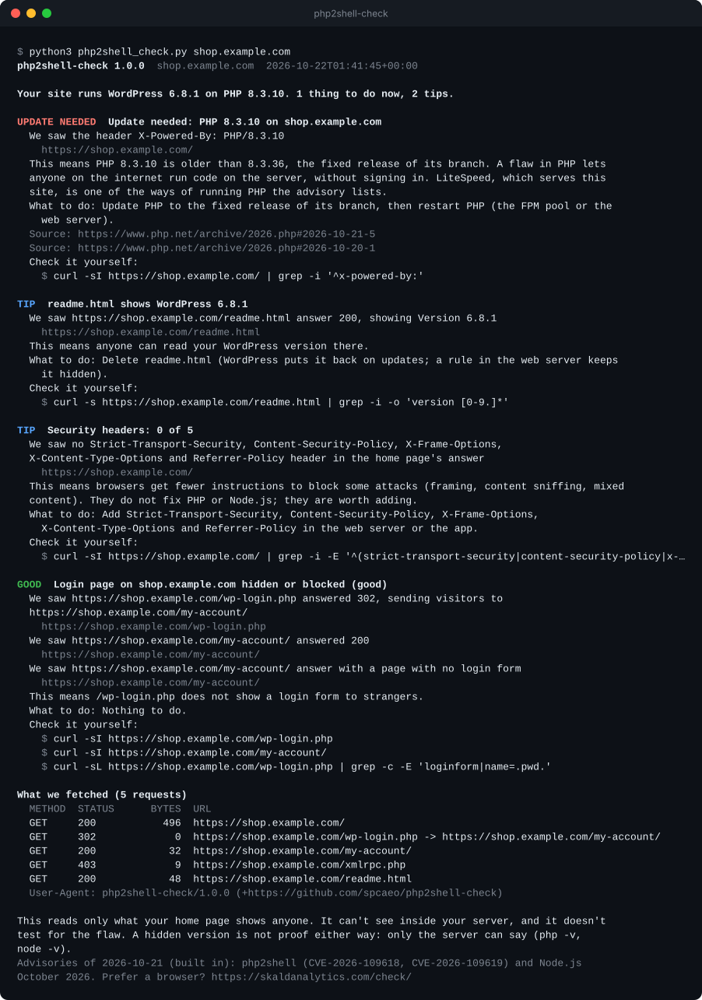

# php2shell-check: is your site exposed to the October 2026 PHP flaws?

[](https://github.com/spcaeo/php2shell-check/actions/workflows/test.yml)
[](LICENSE)
[](https://www.python.org/)
[](php2shell_check.py)

A small, open-source command-line check for **php2shell** (CVE-2026-109618 and
CVE-2026-109619, the October 2026 PHP remote code execution flaws) and the **Node.js
October 2026 security releases**. It reads what your site shows anyone from outside and
tells you what it found. Every finding comes with the evidence, the URL it came from, and a
`curl` command so you can check it yourself.

One Python file, standard library only, Python 3.9 or newer. MIT licence. (The source is
the package [`php2shell_check/`](php2shell_check/); the single file is built from it.)

## Quick start

```sh
curl -sSL https://raw.githubusercontent.com/spcaeo/php2shell-check/main/php2shell_check.py | python3 - example.com
```

Or download it once and run it: `python3 php2shell_check.py example.com`. With pipx:
`pipx run --spec git+https://github.com/spcaeo/php2shell-check php2shell-check example.com`,
or from a clone: `python3 -m php2shell_check example.com`.



<sub>Real output, made by `python3 tools/make-screenshot.py` from the test fixture
`wordpress-woocommerce-litespeed` (example.com names). Lines longer than the picture end in "…".</sub>

## What is php2shell?

- **The flaws.** On 21 October 2026 the PHP project released fixes for CVE-2026-109618 and
  CVE-2026-109619: unauthenticated remote code execution, so anyone on the internet could
  run code on a server without signing in. Fixed in **PHP 8.5.12, 8.4.27, 8.3.36 and
  8.2.35**. PHP 8.1 and older get no official fix.
  ([php.net, 21 October 2026](https://www.php.net/archive/2026.php#2026-10-21-5))
- **How serious.** The PHP project's announcement of 20 October rates them **CVSS v4 9.2**.
  ([php.net, 20 October 2026](https://www.php.net/archive/2026.php#2026-10-20-1))
- **The name, and attacks.** Cloudflare calls them "php2shell". It reports attacks
  observed, says the flaws leaked before the release, and tells customers to patch even
  with its firewall (WAF) rules in place.
  ([Cloudflare blog](https://blog.cloudflare.com/php-vulnerabilities-waf-protection/))
- **Node.js too.** Node.js published its October 2026 security releases.
  ([nodejs.org](https://nodejs.org/en/blog/vulnerability/october-2026-security-releases))
  This tool checks for both, because a Next.js site runs on Node.js.

## What it checks

It fetches your home page (following redirects to the final page) and reads:

- the `Server`, `X-Powered-By`, `Link` and other headers, exactly as sent;
- the generator tag and the paths of the files the page loads (`/wp-content/`, `/_next/` ...);
- cookie **names** (never their values).

On a WordPress host of your own domain it also reads `/wp-login.php` (is the login form
open to anyone?), `/xmlrpc.php` (is XML-RPC on?) and `/readme.html` (does it show the
version?). When your page loads its content from a WordPress on another host of the same
domain (a headless WordPress), it reads that host's login page, `/wp-json/` and home page
(HEAD) too. At most 8 requests in all, GET and HEAD only, each one listed in the result.

Then it sets what it found against the advisories built into the file:

| You'll see | When |
| --- | --- |
| **UPDATE NEEDED** | The server sent a PHP or Node.js version older than the fixed release of its branch (or a branch with no official fix). |
| **LOGIN OPEN** | `/wp-login.php` ends in WordPress's login form. |
| **CHECK** | PHP or Node.js runs your site, but the server hides its version: only `php -v` / `node -v` on the server can say. |
| **COULD NOT CHECK** | Something could not be read (a bot challenge, an error, the request limit). Nothing is guessed. |
| **TIP** | The server shows its exact version, XML-RPC is on, `readme.html` shows the version, security headers are missing, or the certificate ends within 14 days. |
| **INFO** | A firewall sits in front, or a WordPress on another host of your domain. |
| **GOOD / FIXED** | A platform patches PHP and Node.js for you, the version shown has the fix, the login page is hidden. |

### Platforms it recognises

| Family | Platforms | What it means for these flaws |
| --- | --- | --- |
| PHP CMS and shops | WordPress (WooCommerce, multisite, headless), Drupal, Joomla, Magento, PrestaShop, OpenCart, Craft CMS, TYPO3, Statamic | Runs on PHP: check or update PHP. |
| PHP frameworks | Laravel, Symfony, CodeIgniter (by their own cookies) | Runs on PHP. |
| Node.js apps | Next.js, Nuxt, Remix, SvelteKit, Angular Universal, Express, Ghost | Runs on Node.js: check or update Node.js. |
| Static generators | Gatsby, Astro, Hugo | Node.js only builds them: nothing applies. |
| Hosted platforms | Shopify, Wix, Squarespace, Webflow, HubSpot CMS, WordPress.com, WordPress VIP | The platform patches PHP and Node.js for you. |
| Hosting | Vercel, Netlify | They run and patch Node.js for you (not PHP on another server). |
| Web servers | nginx, Apache, LiteSpeed, OpenResty, Microsoft IIS, Caddy | A version shown is a tip; LiteSpeed is one of the ways of running PHP the advisory lists. |
| Firewalls and CDNs | Cloudflare, Fastly, Akamai, CloudFront, Sucuri | A second line, not the fix (with what Cloudflare says about php2shell). |

### The rules it keeps

- **Evidence for every finding:** the exact header line, tag, cookie name or page
  reference, the URL, and a `curl` command that shows the same thing.
- **"Could not check", never a guess.** A bot challenge, an error page or a request limit
  is said as such.
- **Versions only from what the server sent.** Never from a theme, a year or a file name.
- **"Update needed" only with a version read.** A hidden version is "check", not "affected".

## What it can't see

This reads only what your home page shows anyone. It can't see inside your server, and it
doesn't test for the flaw: it never sends an attack, a form or a password.

- **A hidden version** (`expose_php = Off`, a proxy that strips `X-Powered-By`) is good
  practice, but the flaw works either way. Only `php -v` on the server can say.
- **Only what the home page shows.** A PHP app on another path or host that the home page
  doesn't link to is not seen.
- **A firewall or bot challenge** in front may answer instead of your site: then it says
  "could not check", shows what it saw (the status, the challenge's mark, the firewall its own
  headers name: Cloudflare, Sucuri, Akamai, AWS WAF ...) and how to see the details: run it from
  a machine the firewall lets through, or by hand (`curl -sI https://<host>/ | grep -iE
  "server|x-powered-by"`, and `php -v` on the server). It never disguises itself to get past one.
- **A CDN can hide your server's own headers.**
- **The mitigations** (php.ini settings, request limits at the proxy) are not visible from
  outside.

## Options

```text
php2shell-check URL [--json] [--fail-on update_needed|check|any] [--timeout 10]
                    [--max-requests 8] [--user-agent UA] [--advisories-url URL]
                    [--allow-private] [--color auto|always|never]
                    [--write-json FILE] [--write-markdown FILE]
```

| Option | What it does |
| --- | --- |
| `--json` | Print the answer as JSON: the same structure as the web check's API (`summary`, `cards` with `saw`, `means`, `advice`, `fetched` ...). |
| `--fail-on LEVEL` | For CI: exit 1 when a finding is at or above the level. `update_needed`: a version read that needs the fix. `check`: also a hidden version, an open login page, or something that could not be checked. `any`: also tips. |
| `--timeout SECONDS` | Per request (default 10). |
| `--max-requests N` | Requests in all, redirects included (default 8). |
| `--user-agent UA` | The User-Agent sent (default `php2shell-check/1.1.0 (+https://github.com/spcaeo/php2shell-check)`). |
| `--advisories-url URL` | Load a newer advisory list (https JSON). Off by default. |
| `--allow-private` | Check a site of your own network (see Safety). |
| `--write-json`, `--write-markdown` | Also write the JSON answer, or a Markdown report, to a file. |

Colours are on in a terminal and off when piped; `NO_COLOR` turns them off.

**Exit codes:** `0` clean (or no `--fail-on`), `1` findings at or above `--fail-on`, `2`
could not check (the site did not answer, a bot challenge, or an address it refuses).

### Newer advisories

The advisories ship inside the file. When a new one is published, it goes into
[`advisories.json`](advisories.json) in this repo first, then into the file at the next
release. To use the newest list without waiting:

```sh
python3 php2shell_check.py example.com --advisories-url https://raw.githubusercontent.com/spcaeo/php2shell-check/main/advisories.json
```

A list that is not valid, or older than the built-in one, is ignored (with a warning).

## GitHub Action

Check your site every day and after each deploy, with a job summary of the findings:

```yaml
# .github/workflows/php2shell-check.yml
name: php2shell-check
on:
  schedule:
    - cron: "17 6 * * *"        # every day at 06:17 UTC
  deployment_status:             # after each deploy
  workflow_dispatch:

permissions:
  contents: read

jobs:
  check:
    if: github.event_name != 'deployment_status' || github.event.deployment_status.state == 'success'
    runs-on: ubuntu-latest
    steps:
      - uses: spcaeo/php2shell-check@v1   # or pin a full commit SHA
        with:
          url: https://www.example.com/
          fail-on: update_needed        # update_needed | check | any | none
          json-output: php2shell-check.json
```

| Input | Default | |
| --- | --- | --- |
| `url` | (required) | The site to check. |
| `fail-on` | `update_needed` | Fail the step at or above this level, or `none`. |
| `json-output` | (a temp file) | Where to write the JSON answer. |
| `python-version` | `3.12` | The Python that runs the check; the job's own Python is not changed. |

Outputs: `exit-code`, `summary` and `json-file`. A site that could not be checked fails
the step (exit 2); add `continue-on-error: true` if you would rather it didn't.

## Safety

It's a CLI, but people run it in CI with internal DNS, so it keeps the same address rules
as the web check:

- http and https on ports 80 and 443 only, no `user:password@`;
- never an IP address in any form (`127.0.0.1`, `[::ffff:127.0.0.1]`, `2130706433`,
  `0x7f.1`, `127.1`), never a name that only works inside a network (`localhost`,
  `*.local`, `*.internal`, `*.lan`, `*.home.arpa` ...);
- the name is resolved by the tool and refused whole when **any** of its addresses is
  loopback, private, link-local, CGNAT, multicast, reserved or a cloud metadata address
  (IPv4 inside IPv6 too), and the connection goes to the very address checked, so DNS
  can't be switched in between;
- every redirect is checked again; a WordPress login redirect is followed only within your
  own domain;
- GET and HEAD only, no cookie, no credentials. It never asks for a secret file (`.env`,
  `.git`, backups) and never lists users.

`--allow-private` lifts the private-address and inside-name rules, for a check of your own
internal site. Cloud metadata, multicast and unspecified addresses stay refused.

## Prefer a browser?

The same check runs at **https://skaldanalytics.com/check/**, with a shareable report.

## See who is actually probing your server

This check shows what anyone can see. Your server log shows who is actually probing you:
[Skald](https://github.com/spcaeo/skald) is source-available server-log analytics with a
Security section (scanner probes, attack attempts, whether anything was handed out, and the
advisories that apply to your stack, every day).

## Contributing

New platforms are welcome: a detector plus a test fixture. See
[CONTRIBUTING.md](CONTRIBUTING.md). To report a security problem in the tool itself, see
[SECURITY.md](SECURITY.md).

## Licence

MIT, see [LICENSE](LICENSE). Derived from Skald's public site check
(github.com/spcaeo/skald), relicensed MIT by its authors (see [NOTICE](NOTICE)).
